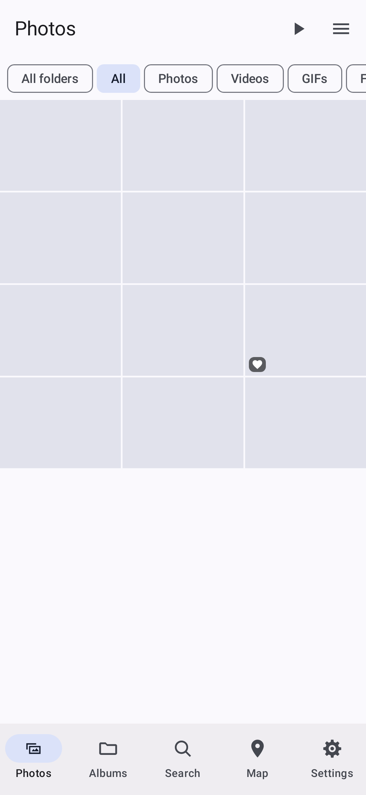
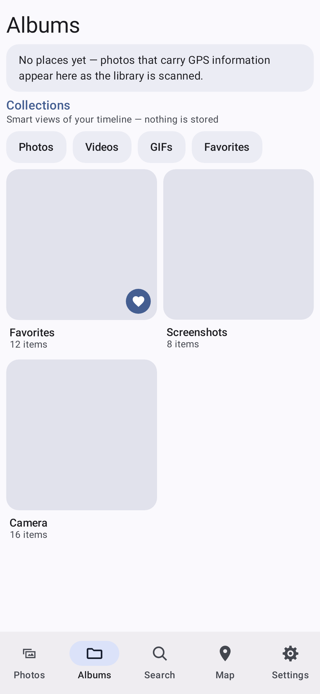
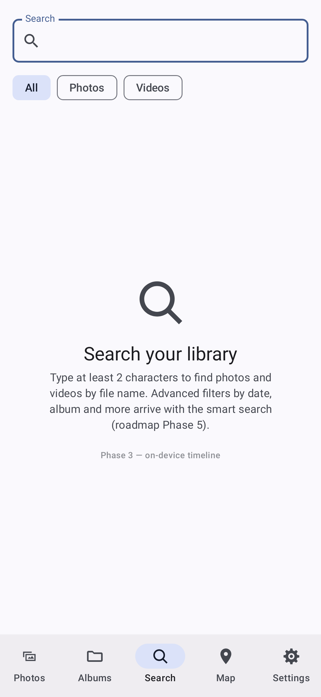
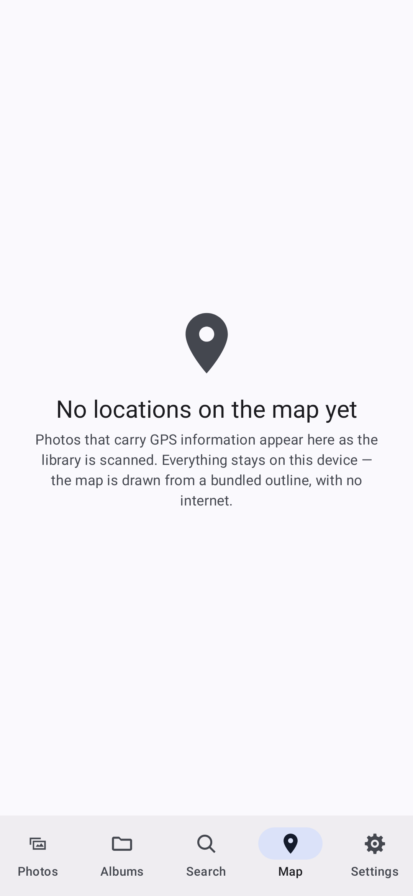
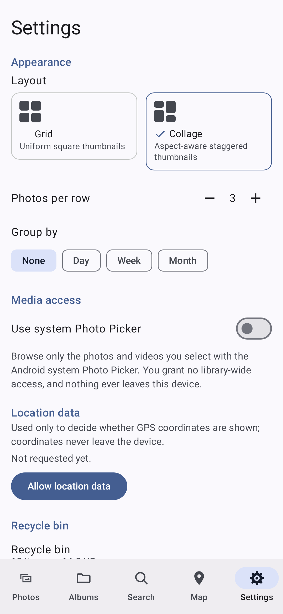

# toadGALLERY

**A single, private, offline-first Android gallery** that browses and organises like
Mi Gallery, exposes metadata like Aves libre, edits like Mi Gallery's editor, and
respects your data like Fossify --- **built from scratch in Kotlin + Jetpack Compose**.

> Inspired by Mi Gallery (editor UX, organisational features), Aves libre (metadata
> depth, collections), and Fossify Gallery (privacy posture, offline-first). **No code
> is ported from any upstream** (ADR-0008) --- only features, UI/UX, and designs. No
> Flutter. No accounts, no cloud, no ads, no analytics. Core functionality works fully
> offline. The gallery's only `INTERNET` grant is the allowlist-gated, opt-in AI-model
> download (ADR-0020); the editor declares none at all.

**Status:** a **four-product family** developed on one shared codebase through a
**virtual fork** branch topology (2026-11-11, [`docs/PROJECT_ARCHITECTURE.md`](docs/PROJECT_ARCHITECTURE.md)):

| Product | App ID | What it is |
|---|---|---|
| **Basic Gallery** | `com.toadgallery` | The focused gallery --- no native code, no AI engine |
| **Gallery Engine** | `com.toadgallery.engine` | The gallery + the vendored Rust/ONNX engine (`-PwithEngine`, ships `libtoad_ml_jni.so` + `libonnxruntime.so`) |
| **Editor** | `com.toadgallery.editor` | The standalone companion editor (`toadGALLERY Edit`) |
| **Unified** | `com.toadgallery.unified` | One combined APK with the complete family feature set |

Phases 0--11 are complete at the code + docs level (`roadmap.md`); the current
version line is `0.4.5-alpha` (gallery/unified, versionCode 46) and
`0.4.14-edit-alpha` (editor). The UI is **Compose-native + Material 3**
(ADR-0009). CI on GitHub Actions per ADR-0013, including a build-time
**INTERNET-permission gate** and an instrumented **privacy egress suite** on an
API 34 emulator --- the app is offline by construction; the gallery's single
allowlisted `INTERNET` grant (ADR-0020, the opt-in model download) is the only
one the gate ever authorizes, and the editor's gate tolerates none at all.

This branch (`main`) is the **stable release line**: it receives approved
stable promotions from `unified` and is the only source of stable releases.
See [Branches --- the virtual fork](#branches--the-virtual-fork) below.

---

## Screenshots

Real screenshots of the app --- captured from the actual Compose UI running on
the JVM via [Roborazzi](https://github.com/takahirom/roborazzi) (the same
pipeline [toadFILES](https://github.com/dukeoftoad/toadFILES) uses), so they
stay in sync with the code: the README suite hosts the real app shell over a
seeded media library and walks the real bottom navigation.

| Photos | Albums | Search |
|:---:|:---:|:---:|
|  |  |  |

| Map | Settings | |
|:---:|:---:|:---:|
|  |  | |

To regenerate them after UI changes (any machine with an Android SDK, or the
CI artifact from the [`screenshots.yml`](.github/workflows/screenshots.yml)
record run):

```bash
./gradlew :gallery:core:recordRoborazziBasicDebug
cp gallery/core/roborazzi/0*.png docs/screenshots/
```

---

## Branches --- the virtual fork

The project is a **family of four products developed from one shared codebase**
using long-lived integration branches ("virtual forks" --- no submodule, no
separate repos; every branch carries the same tree, each specialises in its own
lane). The authoritative policy is
[`docs/PROJECT_ARCHITECTURE.md`](docs/PROJECT_ARCHITECTURE.md); the operator
runbook and pipeline inventory live in
[`.github/BRANCH_STRATEGY.md`](.github/BRANCH_STRATEGY.md).

```text
gallery ─────┐
editor ──────┤
ente sync ───┼── reviewed PR ──▶ unified ── approved stable promotion ──▶ main
features ────┘        (alpha / beta releases)          (stable releases)
```

| Branch | Role | README |
|---|---|---|
| `main` | **Stable release line.** Approved promotions from `unified` land here; stable releases are cut from here only. | this file |
| `unified` | **Primary integration branch.** Receives all product-lane contributions; hosts the alpha/beta lifecycle. | [`unified` README](https://github.com/dukeoftoad/toadGALLERY/blob/unified/README.md) |
| `gallery` | Gallery product lane (Basic + Engine variants). | [`gallery` README](https://github.com/dukeoftoad/toadGALLERY/blob/gallery/README.md) |
| `editor` | Standalone Editor product lane. | [`editor` README](https://github.com/dukeoftoad/toadGALLERY/blob/editor/README.md) |
| `ente` | Upstream **Ente** synchronization lane --- an upstream source lane, *not* a fifth product. | [`ente` README](https://github.com/dukeoftoad/toadGALLERY/blob/ente/README.md) |
| `unified-master` | Archived: the pre-modularization unified line, frozen. No CI, no releases. | [`unified-master` README](https://github.com/dukeoftoad/toadGALLERY/blob/unified-master/README.md) |

**The flow is one-directional by design:** product lanes integrate into
`unified` (alpha/beta feedback builds), and only an explicitly approved,
human-reviewed promotion merges `unified` into `main`. `main` is never the
everyday integration destination. Ente is synchronized selectively and
occasionally (roughly annually); the official Ente distribution is obtained
from Ente directly --- this project does not mirror it as a product.

## Product goals

1. Build **one coherent product family** called toadGALLERY, not competing gallery apps.
2. **Take features, UI/UX, and designs only** from Mi Gallery (proprietary, reference
   only), Fossify Gallery (GPL-3.0, reference only), and Aves libre (BSD-3-Clause,
   reference only). **No code is ported, adapted, or vendored from any upstream.**
3. Build toadGALLERY **from scratch in Kotlin + Jetpack Compose**.
4. Deliver a clean, fast, intuitive gallery with strong media browsing, deep metadata,
   smart search, safe file operations, and a flagship editor.
5. Ship the **Editor** as a separate APK (opened from the gallery via a versioned
   content-URI contract, updatable independently) and the **Unified** APK as the
   all-in-one install; Basic and Engine are the focused gallery cuts.
6. Keep the products private and offline-first: no mandatory account, cloud service,
   ads, analytics, or network access. The gallery's only `INTERNET` grant is the
   allowlist-gated, opt-in AI-model download (ADR-0020); the editor has none.
7. Protect originals by default. Non-destructive editing pipeline; recycle bin;
   PIN/biometric hidden vault.
8. Use **GitHub Actions as the canonical build and CI environment**.

See [`roadmap.md`](roadmap.md) for the full phased plan (Phases 0--11) and
[`docs/product-vision.md`](docs/product-vision.md) for the authoritative north star.

## How the three references contribute (v2.2, ADR-0008)

| Reference | Role in toadGALLERY | What we take | What we deliberately leave |
|---|---|---|---|
| **Mi Gallery** (proprietary) | UX/feature *reference* only | Editor tool layout, Moments/Stories/Auto-albums model, smart-search affordances, collage/slideshow UX, video trim flow | Any code, branding, icons, cloud services, online ML |
| **Aves libre** (BSD-3-Clause) | UX/feature *reference* only | EXIF/IPTC/XMP patterns (reimplemented using `androidx.exifinterface`), tags/ratings/colour labels, collections, on-device map view, format taxonomy | Flutter/Dart UI, the `exifinterface` fork (use AndroidX directly), network tile providers |
| **Fossify Gallery** (GPL-3.0) | UX/feature *reference* only | Privacy posture, offline-first behavior, broad gallery shape | `org.fossify:commons`, any code skeleton, path-keyed Room schema, View-based UI obligation |
| **Jetpack Compose + Material 3** (Apache-2.0) | Canonical UI toolkit | Declarative UI, Material 3 + dynamic color, animation primitives, Compose Canvas | (none --- this is the chosen toolkit) |

Key documents: [project architecture & delivery policy](docs/PROJECT_ARCHITECTURE.md) ·
[branch strategy](.github/BRANCH_STRATEGY.md) ·
[product vision](docs/product-vision.md) ·
[source audit: Fossify](docs/phase-1/source-audit-fossify.md) ·
[source audit: Aves](docs/phase-1/source-audit-aves.md) ·
[integration decisions (ADRs)](docs/integration-decisions.md) ·
[feature matrix](docs/feature-matrix.md) ·
[Compose migration tracker](docs/architecture/compose-migration.md).

## Repository structure

```text
toadGALLERY/
├── .github/workflows/           # CI + release pipelines (the branch-scoped set; see
│                                #   .github/BRANCH_STRATEGY.md for the full inventory)
├── gallery/
│   ├── app/                     # the gallery app: flavors basic / engine (one "engine"
│   │                            #   dimension), applicationId com.toadgallery[.engine]
│   └── core/                    # gallery Kotlin/Compose core + Roborazzi baselines
├── editor/
│   ├── app/                     # toadGALLERY Edit (com.toadgallery.editor)
│   └── core/                    # editor Kotlin/Compose core (AI ONNX models bundled
│                                #   per the model-distribution policy)
├── unified/
│   └── app/                     # the all-in-one app (com.toadgallery.unified)
├── engine/                      # the vendored Rust engine (Ente-derived, cargo-gated;
│                                #   builds libtoad_ml_jni.so for engine/unified builds)
├── shared/                      # editor-contract (the versioned Gallery <-> Edit
│                                #   contract, ADR-0002/0007); video-edit (ADR-0012)
├── docs/                        # architecture, ADRs, phase ledgers, PROJECT_ARCHITECTURE
├── fdroid/                      # F-Droid metadata
├── tools/                       # codegen + CI-signing helpers
├── roadmap.md / CHANGELOG.md / worklog.md / progress.json
└── LICENSE                      # GPL-3.0 (voluntary per ADR-0004/0008)
```

## Build & CI

The canonical build is GitHub Actions (ADR-0013). To build locally you need:

- JDK 17 (Temurin recommended)
- Android SDK with `platforms;android-36` and `build-tools;36.0.0`
- Gradle (project wrapper); Rust toolchain + `cargo-ndk` only for engine work

```bash
# Basic Gallery (property-less --- no native engine)
./gradlew :gallery:app:assembleBasicDebug
./gradlew :gallery:app:lintBasicDebug
./gradlew :gallery:app:testBasicDebugUnitTest :gallery:app:testEngineDebugUnitTest

# Gallery Engine (the -PwithEngine invocation is deliberately separate)
./gradlew :gallery:app:assembleEngineDebug -PwithEngine

# Editor
./gradlew :editor:app:assembleDebug
./gradlew :editor:app:lintDebug
./gradlew :editor:app:testDebugUnitTest :shared:editor-contract:test

# Unified
./gradlew :unified:app:assembleDebug -PwithEngine
```

No Flutter SDK required. No Dart SDK required. The branch-scoped CI workflows are
the source of truth for "does it build" on each lane:
[`ci.yml`](.github/workflows/ci.yml) gates **stable promotion PRs targeting
`main`** (it validates all four products --- Basic build/lint/tests, Editor
build/lint/tests + contract, Engine debug assemble via cargo-ndk, Unified debug
assemble); [`main-release.yml`](.github/workflows/main-release.yml) re-verifies
the four products on every push to `main` as the post-merge safety net.
A green CI check is required to merge any PR.

### Test builds (dispatch surfaces)

- [`unified-apk.yml`](.github/workflows/unified-apk.yml) --- manual debug/release
  dogfood builds of the Unified app (`debug` = CI-debug-key dev build;
  `release` = ADR-0018 signed release compile check).
- [`screenshots.yml`](.github/workflows/screenshots.yml) --- Roborazzi
  `record` / `verify` runs (the committed-baseline gate).
- [`reproducible-build.yml`](.github/workflows/reproducible-build.yml) --- builds
  twice and compares unsigned artifacts on `v*` tags (verification only, no
  secrets, publishes nothing).

## Release channels

Release publication is **manual only** (`workflow_dispatch`, zero automated
triggers) and pinned to its canonical source branch --- the full contract lives
in [`.github/BRANCH_STRATEGY.md`](.github/BRANCH_STRATEGY.md).

| Channel | Source branch | Workflow | What ships |
|---|---|---|---|
| **alpha / beta** | `unified` | `release-unified.yml` | the four-product bundle: `toadGALLERY-<v>-r<N>.apk`, `toadGALLERY-engine-<v>-r<N>.apk`, `toadGALLERY-editor-<v>-r<N>.apk`, `toadGALLERY-unified-<v>-r<N>.apk` (GitHub **pre-releases**) |
| **stable** | `main` | `release-main.yml` | the same four-product set, published as a regular (non-prerelease) release after an approved promotion |

**Slim release pages:** the release page carries the signed APKs *only*. Each
APK's `.sha256` checksum and its R8 `mapping.txt` ride the **Actions run
artifacts** (14-day retention) --- open the release workflow's run in the
Actions tab to fetch the mapping for crash symbolication.

Every published APK passes a hard `apksigner` gate against the pinned signer
certificate SHA-256 digest
(`8a4640e0732e28b84c2fa35ee7a350d104ce97d87df92262cc8439832bd29494`), so an
unsigned or wrongly-signed APK cannot publish. Verify a downloaded release with:

```bash
sha256sum -c toadGALLERY-<version>-r<round>.apk.sha256   # from the run artifacts
apksigner verify --print-certs toadGALLERY-<version>-r<round>.apk
# Signer #1 certificate SHA-256 digest must equal the pinned digest above
```

All four products install on **Android 8.0+** under distinct app IDs and update
independently. Local builds are unaffected: without the signing env vars the
release build falls back to unsigned. Release documentation lives in
[`docs/phase-11/`](docs/phase-11/): release notes, known limitations,
permissions/privacy declaration, FOSS review, F-Droid metadata, and
reproducible-build instructions.

## Upstream references (recorded 2026-10-29)

| Project | Recorded commit | License | Role under ADR-0008 |
|---|---|---|---|
| Fossify Gallery v1.14.1 | `e9812299b9d444b…` (`main`) | GPL-3.0 | Reference only (no code ported) |
| Aves 1.15.8+182 | `4f940ae48bd936…` (`develop`) | BSD-3-Clause | Reference only (no code ported, including the `exifinterface` fork) |
| Mi Gallery | (proprietary, no pinned commit) | Proprietary | UX/feature reference only (no code, no assets, no trademark) |
| Ente (upstream) | synchronized selectively via the `ente` lane | AGPL-3.0 (upstream) | Upstream integration lane only --- not a product, not a code port into the Kotlin apps |

## Roadmap at a glance (v2.2)

| Phase | Focus | State |
|---|---|---|
| **0** | Align scope, establish baselines | **Exited** --- [sign-off](docs/phase-0/sign-off.md) |
| **1** | Source audit, integration design, contract prototype | **Delivered** --- audits, matrix, ADRs, diagrams, license report; reframed as reference-only under ADR-0008 |
| **2** | Product shell, visual foundation, privacy hardening, Compose toolchain, CI | **Exited** --- Compose-native shell 0.2.x; CI as merge gate (ADR-0013); privacy gates + test suites enforced |
| 3 | Core media access, browsing, file ops, recycle bin, hidden vault | **Done** --- 16/16 issues closed by PR #70 |
| 4 | Aves-grade metadata layer (`androidx.exifinterface` + own IPTC/XMP wrappers) | **Done** --- r10--r20 merged (#78--#92) |
| 5 | MI-style organisational UX + the on-device AI port (People, Places, Things, Magic Search) | **Code-side complete** --- r21--r28 + the r39 ente-port exit round |
| 6 | toadGALLERY Edit v1: core adjustments + non-destructive pipeline | **Done** --- r29--r32 merged (#104--#106) |
| 7 | toadGALLERY Edit v2: filters and annotations | **Done** --- r33--r38 merged (#107, #109--#113) |
| 8--9 | (folded into Phase 10 by the 2026-11-04 directive) | **Skipped** |
| 10 | Hardening + Edit v3 AI editing + the lightweight video editor | **Done** --- r40--r42 merged (#117--#119) |
| 11 | Release readiness (F-Droid metadata, FOSS review, signing, v1.0 cut) | **In progress** --- signing + release pipelines live (ADR-0018); the v1.0 stable cut and F-Droid submission remain |

Progress is tracked in the repository **milestones** (one per phase) and **issues**.

## License

**GPL-3.0** --- see [LICENSE](LICENSE). Per ADR-0004 (clarified by ADR-0008), this is a
**voluntary** choice that aligns with the FOSS/gallery community ethos; the product
derives from no upstream code. Third-party dependencies (AndroidX, Compose, media3,
Coil, `androidx.exifinterface`) are Apache-2.0 and attributed per their terms in
[licensing-and-attribution.md](docs/licensing-and-attribution.md). This is engineering
compliance tracking, not legal advice.
