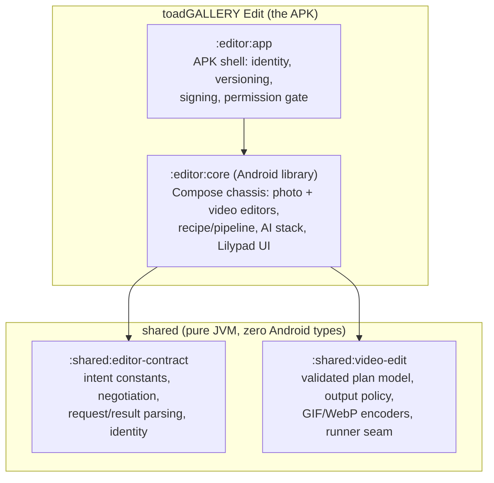

# toadGALLERY Edit — Architecture

This is the single architecture document for the editor-only tree: the standalone
**toadGALLERY Edit** APK, its library, and two pure-JVM support modules. The Gradle
build contains exactly four modules (`settings.gradle.kts`): `:editor:app`,
`:editor:core`, `:shared:editor-contract`, `:shared:video-edit`. The gallery,
unified-app, and ML-engine trees are not part of this repository; wherever an earlier
decision referenced them, only its still-relevant editor half is carried here.

## 1. Overview

toadGALLERY Edit is an **offline-first, non-destructive photo and video editor for
Android**, distributed as its own APK so it can ship, update, and be removed
independently of any gallery. It works in two modes: **contract mode** — a gallery (or
any app that speaks the contract) launches one of the editor's exported activities with
a read-granted `content://` URI and receives the saved copy or a structured error — and
**standalone mode** — launched from the launcher, media opened through the Android
pickers. Every guarantee below holds in both modes:

1. **Originals are never modified.** The source URI is read-only by construction; every
   export is a new MediaStore entry ("save a copy"). No replace-original path exists.
2. **Edits are data, not pixels.** A session is a serialized recipe over the original
   (Section 3); it persists across process death and is cleared on export.
3. **Inference is on-device only.** No cloud ML call anywhere, ever. The four ONNX
   models are not bundled; they download on demand from one pinned host after an
   explicit consent (Section 6).
4. **Honest degradation, never a crash.** Missing models, a broken runtime, an
   unresolvable reference, a failed download — each answers a dedicated message or a
   degraded render; the rest of the editor keeps working.

**License.** The product is GPL-3.0 (root `LICENSE`); the choice is voluntary.

**Upstream policy — reference only.** Fossify Gallery (GPL-3.0), Aves libre
(BSD-3-Clause), and Mi Gallery (proprietary) contribute **features, UI/UX, and design
inspiration only**. Zero code is ported, vendored, or adapted from any upstream; no
proprietary asset, icon, or trademark enters the tree. Interaction patterns from market
editors (Lightroom, Snapseed, Darkroom, VN/CapCut) are re-derived from behavior; every
line of code is original.

**Build profile.** minSdk 26, target/compile SDK 36, Kotlin 2.3.10, AGP 9.2.1, Java 17.
UI is Jetpack Compose + Material 3 (no Views, no Flutter). The editor application ID is
`com.toadgallery.editor` (debug builds carry the `.debug` suffix). Release builds are
R8-minified; signing is env-driven (Section 8).

## 2. Module graph



External dependencies (all Apache-2.0): androidx.compose/Material 3, androidx.media3
1.11.1, `onnxruntime-android` 1.31.1, and `androidx.exifinterface` — consumed by
`:editor:core`.

| Module | Kind | Responsibility |
|---|---|---|
| `:editor:app` | Android application | The installable shell: application ID, `versionCode`/`versionName`, signing config, the single INTERNET grant, the application-level contract marker, and the **permission gate** — a merged-manifest task anchored on every `assemble*`/`bundle*`/`check` (Section 6.5). |
| `:editor:core` | Android library (Compose) | Everything functional: the photo chassis (`EditActivity`), the video chassis (`video/VideoEditActivity`), recipe + codec + store (`EditRecipe.kt`), the pixel pipeline (`EditPipeline.kt`), the AI stack, the Lilypad UI kit, the export machinery, and the contract activities' manifest entries. |
| `:shared:editor-contract` | **Pure JVM** | The Gallery–Edit protocol as code: actions, extras, result/error codes, version negotiation, request validation (`content://`-only), result parsing, editor-identity matching, version-meta-data precedence. |
| `:shared:video-edit` | **Pure JVM** | The video editor's validated plan model (Section 5): `VideoEditPlan`, `FrameExtractPlan`, `AnimationExportPlan`, `VideoOutputPolicy`, the nine-row adjust projection, the multi-clip `ClipTimeline`, crossfade/ramp/music/text-overlay models, and the project-authored GIF/WebP encoders. The only media3-touching code lives above it. |

Dependency directions are one-way: `:editor:app` → `:editor:core` →
`{contract, video-edit}`. The shared modules never depend on anything Android; this is
what keeps the protocol and the plan semantics unit-testable on the plain JVM, without
an emulator.

## 3. Non-destructive pipeline

### 3.1 The recipe model

`EditRecipe` (in `:editor:core`) is the full declarative state of an edit session,
serialized as a **versioned JSON sidecar** in app-private storage keyed by the source
content URI. Versioning is additive: unknown keys are ignored on parse; a wrong-typed
or out-of-range value is a structured parse failure, never a crash or a silent default.
The recipe covers ten layer families:

| Family | Recipe state | Kind |
|---|---|---|
| Geometry | quarter turns, flips, straighten, crop rect, perspective quad | pixel stages |
| Tone | exposure, brightness, contrast, highlights, shadows, whites, blacks | pixel stage (one composed LUT) |
| Colour | saturation, temperature, tint, vibrance, 8-band HSL | pixel stages |
| Curve | master + per-channel R/G/B tone curves | into the tone LUT |
| Look | `.cube` LUT selection + intensity | pixel stage |
| Text / stickers / strokes | layer lists (OFL fonts; imported or bundled art) | compositing passes |
| Regions | mosaic / blur painted regions (RLE masks over canvas fractions) | pixel stage |
| Frame | a single frame mounting | compositing pass |
| AI | `aiErase` (a list), `sky`, `bokeh`, `retouch` (singles) | pixel stages (Section 6) |

Every family carries the same **tolerance contract**: an absent key loads clean (an
older sidecar round-trips byte-clean); an unresolvable id or artifact reference
round-trips verbatim and degrades honestly at render; numerics coerce to family
defaults; a malformed container is a structured parse failure.

### 3.2 Session semantics

- **Save-on-commit / restore-on-relaunch:** every committed change writes the recipe;
  process death restores the session. Undo/redo is a bounded snapshot stack over whole
  recipes, per-family commit granularity.
- **Clear-on-export:** a successful export clears the stored session.
- **The identity fast path:** a recipe where every family is neutral returns the input
  pixels exactly — an untouched session's saved copy is a pure re-encode.

### 3.3 The pipeline

`EditPipeline` applies a whole recipe in **one documented stage order**, so preview and
export agree byte-for-byte by construction (the one-shared-compositor pattern: both
render through the same resolver and compositor call sites):

```
flip -> straighten -> perspective -> quarterTurns -> crop ->
tone LUT -> saturation -> temperature/tint -> HSL bands -> LUT filter ->
vignette -> sharpen -> AI erase -> AI sky -> AI bokeh -> AI retouch ->
mosaic/blur regions
```

Text, stickers, and strokes are compositing passes over the output canvas, not stages.
The order is semantic: the mosaic regions stage is **final** — no downstream stage
re-processes censored pixels — and the AI stages sit between sharpen and regions
(Section 6.1). The session edits a bounded preview decode (2048 px max dimension); masks
and geometry live as output-canvas fractions, exact at any grid; export re-decodes full
and replays the identical pipeline.

### 3.4 Export

Export is always **save-a-copy**: a MediaStore INSERT of a NEW row (`IS_PENDING` on
API 29+ while bytes land; a failed write cancels the pending row, so no partial entry
survives). Formats: JPEG (quality control), PNG, WebP — no HEIC encoder path exists.
`ExportPreflight` guards decode and storage before work starts. The launch request's
metadata policy is a **privacy floor**: the export sheet may offer a stronger
per-export choice, never a weaker one, and `RESULT_OK` echoes the policy actually
applied (`EXTRA_METADATA_POLICY_APPLIED`) so the caller can narrate honestly. EXIF
handling rides `androidx.exifinterface`.

## 4. Gallery ↔ Edit contract

The contract is specified once as pure-JVM code in `:shared:editor-contract`
(`EditContract.kt` is the frozen constant surface; ADR-0002/0007); both sides consume
the same module, so the wire has a single source of truth. v1 fields are frozen; v2
added one optional field only; future changes may only add optional fields or bump the
minimum explicitly.

**Identity & discovery.** The editor's release application ID is
`com.toadgallery.editor` (dogfood builds `+ ".debug"`). Two exported activities filter
on the single contract action `org.toadgallery.action.EDIT`: `EditActivity` (image
mimes: jpeg/png/webp/heic, activity-level contract marker `1`) and
`video.VideoEditActivity` (video mimes: mp4/quicktime/3gpp, marker `2`). The
application element carries a fallback marker (current version) for resolvers whose
PackageManager query returns an empty meta-data bundle. Version resolution follows a
pinned precedence rule: a valid activity-level marker wins, otherwise the
application-level marker, otherwise unknown. Callers resolve by action **and** exact
application-ID match — never implicit resolution — and handle three states: not
installed, outdated (below the caller's minimum, `MIN = 1`), and disabled.

**Launch (caller → editor).** Extras:

| Extra | Meaning |
|---|---|
| `EXTRA_CONTRACT_VERSION` | the negotiated version |
| `EXTRA_SOURCE_URI` | the source media, also mirrored to `ClipData`; read grant scoped to this URI only |
| `EXTRA_OPERATION_HINT` | optional entry-tool hint (`crop`, `rotate`, `resize`, `draw`, `adjust`, `filter`); UI pre-selection only |
| `EXTRA_EXPORT_MODE` | `save_copy` — the only mode; replace-original does not exist |
| `EXTRA_METADATA_POLICY` | `preserve` (default) / `strip_location` / `strip_all` — the privacy floor |
| `EXTRA_MEDIA_KIND` | **additive v2**: `image` (the v1 default when absent) or `video`; an unknown value is a contract violation, not a fallback |

Absolute filesystem paths are forbidden on the wire; `EditRequestValidator` admits
`content://` URIs only and fails structured before any UI exists.

**Results (editor → caller).** Terminal states:

| Result | Extras | Meaning |
|---|---|---|
| `RESULT_OK` | `EXTRA_OUTPUT_URI`, `EXTRA_METADATA_POLICY_APPLIED` | the saved copy exists; refresh via MediaStore observation, no rescan |
| `RESULT_CANCELED` | — | the user backed out; nothing was modified anywhere |
| `RESULT_ERROR` | `EXTRA_ERROR_CODE`, `EXTRA_ERROR_MESSAGE` | structured failure: `ERROR_VERSION`, `ERROR_UNSUPPORTED`, `ERROR_IO`, `ERROR_PERMISSIONS`, `ERROR_INTERNAL` |

`RESULT_FIRST_USER` is reserved; the contract's own error result allocates `2` so an
accidental first-user reply can never masquerade as OK or CANCELED. The applied-policy
echo is additive (older editors omit it; parsers tolerate the absence) and exists so
the caller can narrate honestly ("location removed") without guessing.

## 5. Video editor

The video editor lives in `:editor:core/video/` with all policy as **pure data** in
`:shared:video-edit` — the `ExportPlan` pattern video-shaped: the plan encodes every
rule, validation, and cap; the activity merely executes it. Out-of-bounds input is a
plan failure with an honest message, never a silent clamp.

- **Trim** — a validated `TimeRange` (`0 <= start < end <= duration`; clip duration
  supplied as a plan input). A/V alignment shifts both streams to the trim start.
- **Speed** — a sorted, non-overlapping list of `{startMs, endMs, factor}` segments
  over the trim range; factors within 0.25×–2.0×; gaps ride at 1×; per-segment source
  time strictly increases (no plan may fold time backwards); derived output duration
  (`Σ length / factor`) is pure math. The v1 surface exposes whole-clip or one region;
  the model stays general. Preview realizes the plan via playback speed, export via
  the Transformer speed API — one model, two realizations.
- **Audio** — `audioTrackPresent` is an input fact: mute on a no-audio clip is a
  **recorded no-op** (the UI states "no audio track" instead of a dead toggle); mute
  on a normal clip strips the track. The single approved ADR-0012 §5 extension is one
  gain (`volume`, 0..2, default 1) as `GainProcessor` in export and `player.volume` in
  preview. No mixing, no replacement.
- **Frame extraction** — one timestamp, JPEG/PNG, one new MediaStore entry.
- **Animation export** — an in/out range, target width 64–1280 px, fps 2–30, GIF or
  WebP; the frame count and a **32 MiB byte-budget preflight** are pure math;
  over-budget requests are refused before any render.
- **Adjustments** — exactly nine shader-capable rows map onto video (brightness,
  contrast, exposure, highlights, shadows, saturation, temperature, tint, vignette);
  `VideoAdjustProjection` is table-conformance-tested so nothing else leaks onto video
  (HSL, sharpen, LUT looks, regions, geometry, AI are off-video). The same GL uniform
  struct feeds the ExoPlayer preview and the export effect chain; a neutral set attaches
  no effect at all (an exact identity).
- **Multi-clip timeline** — `ClipTimeline`, `ClipExportRequest`/`ClipExportProjection`,
  crossfades, speed ramps, a music track, and text overlays as plan-level models.
- **Output policy** — `VideoOutputPolicy`: INSERT-only into MediaStore, the
  `IS_PENDING` discipline, the per-format `-edit` naming rule, no replace-original
  path. The GIF LZW encoder and animated-WebP muxer are project-authored pure Kotlin
  (media3 ships no such encoders).

**Export path.** Preview is `ExoPlayer`. Export runs media3 `Transformer` behind the
`VideoExportRunner` seam: `Media3VideoExportRunner` is the only file whose export path
touches Transformer (`EditedMediaItem` chain, `SpeedParameters` per segment,
`setRemoveAudio` for mute, progress polled, cancellation mapped honestly). Inputs are
MP4/MOV/3GP (H.264/HEVC + AAC — what the pipeline honestly re-encodes on-device); the
output container is MP4. All of it runs off the UI thread with honest progress and
cancellation.

## 6. AI pipeline

### 6.1 The four features

All four AI features are **pixel stages** in the pipeline tail (erase → sky → bokeh →
retouch), slotted between sharpen and the regions stage. Inference runs at **commit
time only** — when the user applies or re-applies a feature — off the UI thread,
cancellable, with honest progress. Inference produces a **derived artifact** persisted
in the app-private `edit-ai/` store (atomic writes, append-only per session, swept with
the sidecar on export/clear). Every render replays deterministically from the stored
artifact plus the layer's parameters; no model ever runs during render or export.
Parameter changes that do not change the artifact (blur strength, focal depth, sky
opacity, retouch strengths) re-render without re-inference.

| Feature | Flow | Artifact |
|---|---|---|
| Magic erase | painted stroke seeds a mask (`RegionMask`) → segmentation refines the seed → inpainting fills it | refined mask (RLE rows over fractions) + fill patch at working resolution |
| Sky replacement | saliency detection finds the sky once at commit; no sky is an honest refusal | saliency mask; replacement is a project-authored parametric sky or a user import, cover-cropped to the mask box, blended at the selection's opacity |
| Bokeh | depth estimated once; per-pixel blur radius from depth distance to the focal band (integer-deterministic kernels) | quantized 8-bit depth map at a bounded working resolution |
| Face retouch | face localization (boxes + landmarks), then smoothing / eye-brighten / slim-face (a displacement warp), one global selection over all detected faces | normalized face boxes |

Face retouch is **opt-in by default**: hidden until first-use consent is granted (the
dialog states what the model does, that it runs on-device, and that no face data
leaves the device), with a permanent kill-switch in settings. With consent off the
stage refuses to run even if a restored sidecar carries a retouch layer.

### 6.2 Degradation-not-crash

Every failure answers a dedicated, honest boundary — never a crash: the models are
missing from the store (a download refused or failed), the native runtime failed to
load or execute, the sky detection found no sky, or the user cancelled. A missing
artifact renders nothing and the UI says the layer degraded; a missing or wrong-sized
model file answers "absent" for that model only, and the rest of the editor keeps
working.

### 6.3 Inference runtime

The seam is `EditAiEngine` (facade) over ONNX Runtime — the prebuilt Android AAR
(`com.microsoft.onnxruntime:onnxruntime-android` 1.31.1, Apache-2.0), so no NDK build
surface exists. Sessions request **NNAPI first** with CPU fallback; the int8 depth
graph's quantized ops are expected to resolve to CPU. Per-model graph facts (working
grids, input/output names, preprocessing constants cited from upstream) live in
`EditAiModels`; JVM tests exercise the seam over fakes.

### 6.4 The on-demand model store

The four ONNX graphs are **not bundled in the APK**. They download on demand into
app-private storage (`filesDir/models/`) from one pinned public release:
`https://github.com/dukeoftoad/toadGALLERY/releases/download/onnx-models-v1`

| File | Feature | Bytes | License | Provenance |
|---|---|---|---|---|
| `erase-segmentation-u2netp.onnx` | erase mask refinement + sky saliency (one graph, both) | 4,574,861 | Apache-2.0 | U-2-Net `u2netp` (xuebinqin); conversion BritishWerewolf/U-2-Netp |
| `erase-inpaint-migan.onnx` | magic-erase fill | 29,546,882 | MIT | MI-GAN (Picsart-AI-Research); conversion andraniksargsyan/migan |
| `bokeh-depth-dav2-small-int8.onnx` | bokeh depth | 27,258,801 | Apache-2.0 | Depth-Anything-V2-Small int8; onnx-community conversion |
| `retouch-faces-yunet.onnx` | face-retouch localization | 232,589 | Apache-2.0 | YuNet 2023mar (opencv/opencv_zoo) |

Total set: **61,613,133 bytes**, pinned as a literal.

`EditAiManifest.kt` pins each entry (`fileName`, `bytes`, `sha256`) plus the download
tag and base URL; a JVM test asserts the catalog's internal consistency (order, URL
shape, per-file pins, sum == the pinned total), so a size or digest drift cannot ride
unnoticed. `EditAiModelStore.kt` owns the device half:

1. **Consent.** Before any network use, the UI shows an explicit per-batch prompt
   (`editor_ai_download_*` strings): "This tool needs an AI model (N MB) downloaded
   once over the network. Continue?" One prompt covers the missing models of the
   feature batch being applied; declining answers a notice and nothing downloads.
2. **Stream.** The bytes stream (plain `HttpURLConnection`, live percent progress,
   cancellable) into a `models/<name>.part` file.
3. **Verify.** The counted byte size must equal the pin and the streaming SHA-256 the
   pinned digest; either mismatch aborts.
4. **Commit.** The verified `.part` file is atomically renamed into place. Any failure
   or cancellation deletes the `.part` — a failed download leaves no partial file
   behind and never touches an installed model.

Before **every** inference the store re-checks presence + exact byte size (the digest
check belongs to download time; the per-use check is the forgiving gate that degrades a
feature instead of crashing it). A pin change re-reads affected copies as absent, so a
stale file re-downloads via the same consent flow.

### 6.5 Privacy posture

The app's single permission is `android.permission.INTERNET`, and its only use is
fetching the pinned model files from the pinned release host. No analytics, no
telemetry, no crash reporting, no other host, no other request kind; inference, media,
recipes, and artifacts never cross the network — only inert, hash-verified model bytes
do. The `:editor:app` permission gate fails the build on any permission outside the
editor's declared set, so a transitive dependency cannot silently widen it. The library
manifest's only other declared grant is the pre-Q-capped legacy storage write
(`WRITE_EXTERNAL_STORAGE`, `maxSdkVersion="28"`), requested at export time only on
devices where MediaStore own-contribution inserts need it.

## 7. UI layer

### 7.1 The Lilypad design language

Lilypad is the editor's design system ("the interface is the pond; the edit is the
strike"): a dark, chrome-light canvas where the photo is the hero and one accent does
all expressive work. The tokens (`LilypadTokens.kt`), kit (`ProSlider.kt`,
`LilypadCards.kt`, `LilypadDeck.kt`), and their math are pure Kotlin, JVM-pinned.

| Token | Hex | Role |
|---|---|---|
| Pond | `#0B0C0E` | the canvas |
| Pad / Pad raised | `#15171B` / `#1E2126` | sheets; controls and pills at rest |
| Hairline | `#2A2E35` | borders, slider tracks |
| Reed / Paper | `#9BA0A8` / `#F2F1EE` | muted text (≥ 4.5:1 on Pad); text (≥ 7:1) |
| Ember | `#FF6B45` | THE accent — selection, live value, CTA, nothing else |
| On ember | `#2A0E05` | text on ember fills |

Depth comes from lightness steps and hairlines, never drop shadows. Shape: 16 dp sheet
corners, 12 dp controls/cards, 8 dp chips. Type: **Manrope** (OFL-1.1, bundled at
`res/font`) for display/body, **JetBrains Mono** (OFL-1.1) for every numeric readout so
counting digits never jitter layout. Motion: one spring for sheets, short fades, 0 ms
value feedback. Haptics: four primitives only. Targets hold the 48 dp floor; TalkBack
announces every control's name, state, and live value.

The Material 3 bridge roles live in `LilypadTokens.Roles` (scheme mapping in
`EditorPalette.Lilypad`); feature seams (`LilypadFlags`) are the reviewed revert
switches.

### 7.2 The kit and the chassis

- **ProSlider** — the flagship control row: label left, mono value pill right
  (ember-when-live); relative scrub anywhere on the row, long-press fine mode at 10 %
  gain, double-tap neutral, haptic tick on zero crossing, center notch on bipolar
  ranges.
- **Deck** — the three-state bottom sheet (Collapsed 64 dp peek / Half 45 % / Full 78 %)
  hosting every tool panel, with spring motion and its own scroll.
- **LookCard shelf** — looks rendered as cards through the SAME pipeline the export
  uses; press-and-hold compares against the plain original.
- **Adjust board** — every adjustment parameter visible at once, histogram leading; the
  tone-curve deck, RGB parade, and clipping zebra ride the Full deck state.
- **History strip** — a scrubber over the undo/redo snapshot stack.

The photo chassis is a **tool tab bar** over one persistent preview: tabs select a
tool family, panels open on the Deck, the full control surface stays visible, and
commit lands on release (drag is always live-draft). Paint modes (draw / region /
erase) are mutually exclusive — one at a time, enforced at both toggles.

The video chassis (`VideoEditorScreen`) is one scaffold with six real tool tabs (trim,
speed, audio, frames, adjust, export), a committed/draft session model, the real-frame
filmstrip with pinch-zoom timeline (`TimelineStrip`), a two-handle trim strip, and the
nine-adjustment selector live-previewed through the GL effect. Its fixed dark scheme
rides the same token registry — one language across both products.

## 8. Decision log

Superseded ADRs (0001, 0005) and the removed trees' decisions (Paging, vault, biometric
unlock) are dropped; numbers retained for cross-reference.

| ADR | Decision | Outcome |
|---|---|---|
| 0002 | Separate editor APK with a versioned content-URI contract | Accepted — launched by contract, never embedded |
| 0003 | Upstreams tracked as pinned commits, no embedded forks | Accepted — reference pins only; nothing vendored |
| 0004 | Product license GPL-3.0 | Accepted — voluntary; source disclosure on distribution |
| 0006 | URI-first, MediaStore-anchored data model | Accepted — content URIs only, no raw paths in the editor |
| 0007 | Contract v1: content-URI, versioned, additive | Accepted — frozen constants in `:shared:editor-contract`; negotiation by meta-data |
| 0008 | Features/UI/UX/designs only from upstreams; build from scratch | Accepted — zero code ports; GPL-3.0 becomes voluntary |
| 0009 | Jetpack Compose + Material 3 as the UI toolkit | Accepted — all editor surfaces are Compose; no Views, no Flutter |
| 0010 | On-device AI policy | Accepted — no cloud ML ever; face features opt-in with consent; permissive model licenses only. The ship-in-APK clause is superseded by the on-demand store (Section 6.4) |
| 0011 | Non-destructive pipeline as a versioned recipe | Accepted — `EditRecipe` JSON sidecar, additive schema, originals never modified |
| 0012 | Video editor scope and pipeline reuse | Accepted — trim/mute/speed/frames/animation + the nine shader adjustments; parameter set reused, not the photo pipeline; hosted in the Edit APK |
| 0013 | GitHub Actions as the build/CI environment | Accepted — green CI gates every merge; artifacts on tagged releases |
| 0014 | Privacy gates: offline-by-construction | Accepted — merged-manifest permission gate + JVM conformance suite; amended for the model-download INTERNET grant (6.5) |
| 0016 | CI scope: compile + JVM tests | Accepted — device checks run on physical hardware as human release gates, never emulators |
| 0018 | Release signing and pre-release pipeline | Accepted — env-injected signing (keys only as CI secrets), pinned signer-cert digest |
| 0020 | Pinned runtime model download, verified | Accepted — the verify-then-stage-then-commit discipline (pin manifest, size + SHA-256, atomic install, no partial files, per-batch consent) implemented by the editor's model store |

## 9. Licensing summary

| Component | License | Notes |
|---|---|---|
| toadGALLERY Edit (this tree) | **GPL-3.0** | root `LICENSE`; voluntary choice |
| Jetpack Compose, Material 3, AndroidX (activity, exifinterface) | Apache-2.0 | notice + license-text obligations on distribution |
| androidx.media3 1.11.1 (exoplayer, ui, transformer, effect) | Apache-2.0 | declares no permissions |
| onnxruntime-android 1.31.1 | Apache-2.0 | prebuilt AAR |
| Manrope, JetBrains Mono (UI fonts) | **OFL-1.1** | bundled at `editor/core/src/main/res/font/`; license texts kept at `docs/licenses/` |
| Text-tool fonts: Fira Sans, Playfair Display, Caveat, Space Mono | OFL-1.1 | bundled under `assets/fonts/`, `OFL.txt` beside each |
| The four ONNX models (Section 6.4) | Apache-2.0 / MIT | downloaded at runtime; MIT attribution (MI-GAN) on the About screen |
| Bundled LUTs, parametric skies, frames, stickers | project-authored | GPL-3.0; no third-party sky bitmaps or proprietary art ship |
| Fossify Gallery, Aves libre, Mi Gallery | GPL-3.0 / BSD-3-Clause / proprietary | **Reference only** — features and UX inspiration; zero code, zero assets |

Obligations accepted: GPL-3.0 source disclosure for any distributed build (CI is the
canonical recipe); upstream notices preserved; dependencies license-checked
before first release; model attribution recorded and surfaced. MIT and Apache-2.0 are
GPL-3.0-compatible; OFL fonts embed with their license texts. No proprietary asset or
ported code from any upstream — the reference-only policy of Section 1 is also the
licensing policy.
