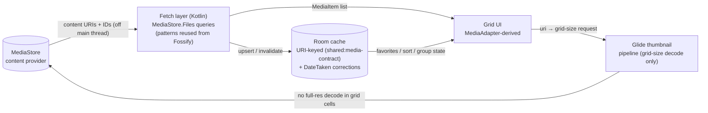
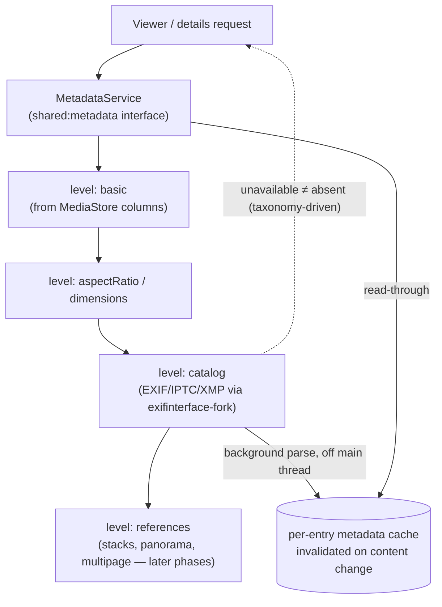
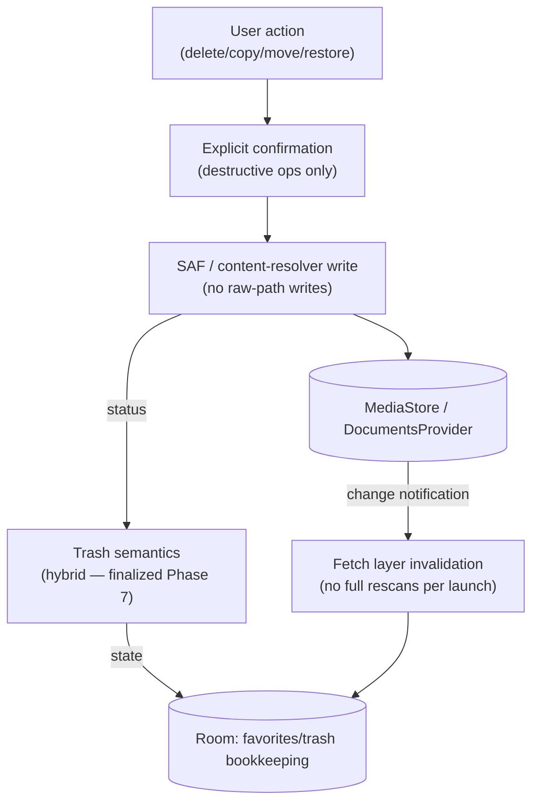
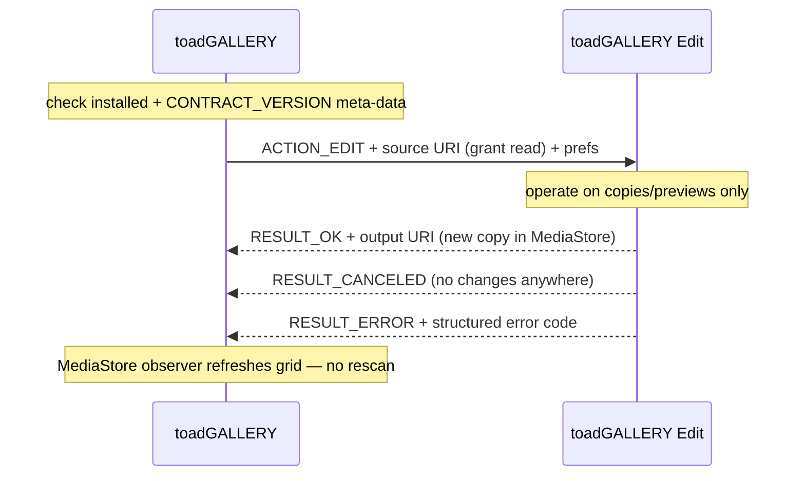

# Data-Flow Diagrams — toadGALLERY v1

**Status:** Phase 1 baseline (2026-10-29) · **Decisions:** ADR-0006 (URI-first), ADR-0001 (stack)

## 1. Media browsing & grid

Rules enforced by this flow: no raw-path queries in the product layer; grid cells never
decode full-resolution originals (roadmap Phase 3 task); fetch work is cancellable
(`shouldStop`-style flag pattern from Fossify retained).

## 2. Metadata details (progressive enrichment — Aves pattern in Kotlin)

## 3. File operations & trash (safe-by-default)

## 4. Gallery → Edit → Gallery round trip (contract v1 — see editor-contract.md)

## Date semantics (ADR-0006, applies to every display/sort/filter)

- `date_added` (MediaStore): import/sync time.
- `date_modified` (MediaStore): file change time (edits via non-our apps included).
- `date_taken` + tz offset (catalog): capture time — **the user-facing default for
  timeline grouping/sorting**; falls back to `date_added` when genuinely absent
  (never silently — the taxonomy distinguishes absent from unknown, Phase 4).
