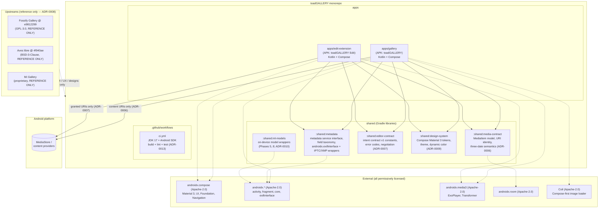

# Module Diagram — toadGALLERY v2.2 architecture

**Status:** Phase 1 baseline revised 2026-10-29 for v2.2 · **Decisions:** ADR-0008
(features-only, no code ports), ADR-0009 (Compose), ADR-0013 (GitHub Actions CI) ·
Companion: `data-flow.md`, `editor-contract.md`, `compose-migration.md`

The module layout reflects ADR-0008 (no `org.fossify:commons`, no Aves `exifinterface`
fork) and ADR-0009 (Compose-native UI). The Phase 2 app shell is in transition: the
View-based + commons shell still builds, and the Compose toolchain is added alongside
it for the incremental migration tracked in `compose-migration.md`.

## Module responsibilities

| Module | Responsibility | Source under ADR-0008 |
|---|---|---|
| `:apps/gallery` | UI shell, browsing, viewer, search UI, trash/favorites, settings; orchestrates metadata + file operations | Reimplemented from scratch in Compose (FOSSIFY-REF + MI-REF) |
| `:apps/edit-extension` | Crop/rotate/flip/resize/draw/filters/adjustments/AI; export pipeline; never touches originals beyond the granted URI | Reimplemented from scratch in Compose (MI-REF) |
| `:shared:media-contract` | `MediaItem` (URI + id + three dates + type), virtual folders (favorites/trash), sort/group vocabulary | Reimplemented from scratch (AVES-REF for the model shape, ADR-0006) |
| `:shared:metadata` | `MetadataService` interface, progressive levels (basic → catalog), field taxonomy (EXIF/IPTC/XMP), capability registry | Reimplemented from scratch using `androidx.exifinterface` (ADR-0008) + own IPTC/XMP wrappers (AVES-REF for taxonomy) |
| `:shared:editor-contract` | Contract v1 constants: actions, extras, result/error codes, version negotiation | Net-new (ADR-0007) |
| `:shared:design-system` | Compose Material 3 color roles, type scale, spacing, shape; day/night; dynamic color; Mi-inspired tokens | Net-new in Compose (ADR-0009) |
| `:shared:ml-models` | On-device ML model wrappers for face clustering, object/scene tagging, semantic embedding, segmentation, inpainting, depth, sky, face retouch | Net-new (ADR-0010) |
| `.github/workflows/ci.yml` | Build, lint, test on every push and PR | Net-new (ADR-0013) |

## Deliberately NOT in the tree

- `org.fossify:commons` (ADR-0008 --- transitional in the alpha shell, removed by
  `compose-migration.md`)
- The Aves `exifinterface` fork (ADR-0008 --- use `androidx.exifinterface` instead)
- Any Flutter/Dart code (ADR-0008 re-affirms ADR-0001's no-Flutter stance)
- Any Mi Gallery code or asset (proprietary; reference only)
- `upstream/` clones (ADR-0003 --- pinned commits in docs, clones are local-only references)
- Network/cloud/casting/analytics modules (excluded by scope decision, Phase 0 sign-off)
