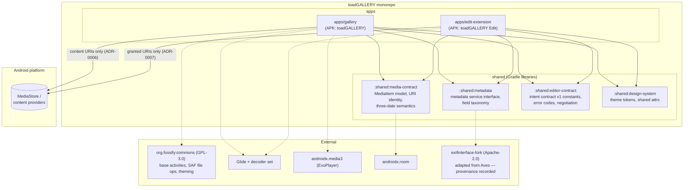

# Module Diagram — toadGALLERY v1 architecture

**Status:** Phase 1 baseline (2026-10-29) · **Decisions:** ADR-0001, 0005, 0006 ·
Companion: `data-flow.md`, `editor-contract.md`

The module layout validates the roadmap §3 proposal against the audit evidence:
`shared/` shrinks to what is *technically justified* (contracts + metadata), `upstream/`
stays out of the tree (ADR-0003), and both apps are Gradle modules in one repo.

## Module responsibilities

| Module | Responsibility | Source |
|---|---|---|
| `:apps/gallery` | UI shell, browsing, viewer, search UI, trash/favorites, settings; orchestrates metadata + file operations | Keep Fossify skeleton (ADR-0001); URI-first model (ADR-0006) |
| `:apps/edit-extension` | Crop/rotate/flip/resize/draw/filters; export pipeline; never touches originals beyond the granted URI | Adapt Fossify editor extraction (ADR-0002) |
| `:shared:media-contract` | `MediaItem` (URI + id + three dates + type), virtual folders (favorites/trash), sort/group vocabulary | Reimplement from Aves `AvesEntry` semantics |
| `:shared:metadata` | `MetadataService` interface, progressive levels (basic → catalog), field taxonomy (EXIF/IPTC/XMP), capability registry | Reimplement Aves architecture; adapt exifinterface fork |
| `:shared:editor-contract` | Contract v1 constants: actions, extras, result/error codes, version negotiation | ADR-0007 |
| `:shared:design-system` | Color roles, type scale, spacing, shape; day/night; Mi-inspired tokens | Phase 2 deliverable |

## Deliberately NOT in the tree

- `upstream/` clones (ADR-0003: pinned commits in docs, clones are local-only)
- Any Flutter/Dart code (ADR-0001)
- Network/cloud/casting/analytics modules (excluded by scope decision, Phase 0 sign-off)
